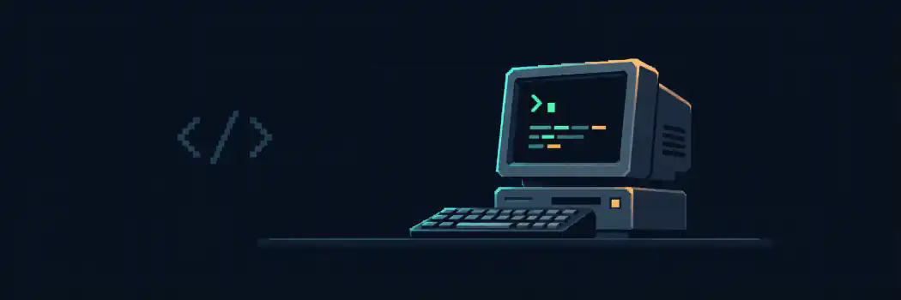

  

<h1 align="center">Hi, I'm Mohamed Abdelkareem</h1>

<strong>Full-Stack Software Engineer</strong>

## About me

I'm a Computer Science graduate and freelance software engineer based in Egypt. I build SaaS products and web applications for clients in Saudi Arabia and the UAE, from designing APIs and databases to building responsive, bilingual interfaces.

## Tech stack

- **Frontend** · TypeScript, React, Next.js, Tailwind CSS
- **Backend** · Node.js, Express
- **Database** · PostgreSQL, Prisma

## Selected projects

- **[Tas3eer Pro](https://tas3eer.org/)** helps contractors manage bills of quantities and turn them into PDF quotes.
- **CupPoints** is a loyalty platform for Saudi businesses to manage points and customer rewards.
- **[Fury](https://github.com/Mohamd-Abdelkreem/fury-manga)** is a manga and novel reading platform with reading progress and a points system.

## Competitive programming

Two-time ECPC finalist. [Codeforces](https://codeforces.com/profile/Abd-El-Kareem) · [LeetCode](https://leetcode.com/u/wChYKWj9pF/) · [AtCoder](https://atcoder.jp/users/Abd_ElKareem) · [ICPC](https://icpc.global/ICPCID/EZUVBQCCHN6B)

## Connect

[LinkedIn](https://www.linkedin.com/in/mohamed-abdel-kareem-08a550216/) · [Email](mailto:mohamedabdelkreem770@gmail.com)
